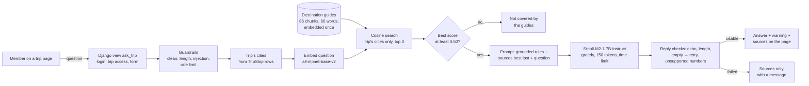

# TakeOff AI features

| Feature | Where | Models | Runs on |
|---|---|---|---|
| **Ask about this trip** (A9, main feature) | trip page → **Ask about this trip**, `/trips/<id>/ask/` | `sentence-transformers/all-mpnet-base-v2` + `HuggingFaceTB/SmolLM2-1.7B-Instruct` | inside the Django server, open models from Hugging Face |
| Day-by-day drafts (A6) | trip page → **Draft my days**, `/trips/<id>/days/` | `HuggingFaceTB/SmolLM2-1.7B-Instruct` | inside the Django server |
| Place suggestions, packing list, place check | trip page → **Find places**, **Packing list** | any OpenAI-compatible hosted model | optional, off unless `AI_API_KEY` is set |

---

## 1. Ask about this trip

A member asks a travel question about the cities on a trip ("Do we need to book the Vatican Museums ahead?",
"Will Venice be flooded in November?"). TakeOff finds the matching passages in its destination guides, the
on-device language model answers from them, and the page shows the answer together with the passages it used.

It is retrieval-augmented generation (RAG) built from our A8 experiments, using the same generator as the
day-by-day drafts, and it uses no paid API.

### 1.1 AI workflow

**What enters the AI system.** One free-text question (up to 300 characters) typed on the trip page. The cities come
from the trip itself (its route stops in the database), never from the member, so a question can only be answered
from the guides for that trip's cities. Any signed-in member can ask about a public trip or their own private trips.

**How the input is preprocessed** (`trips/ai/ask.py`, `trips/ai/guardrails.py`):

1. Length check: more than 600 raw characters is refused before any processing.
2. Cleaning: Unicode normalisation, control characters and symbols such as braces, quotes and angle brackets
   removed, spaces collapsed, cut to 300 characters.
3. Content checks: fewer than 3 letters ("???", "12") is refused as not a question; phrases that try to redirect the
   model ("ignore previous instructions", "system prompt", "password", ...) are refused with a friendly message.
4. Rate limit: 20 questions per member per hour (`AI_ASK_PER_HOUR`).
5. The trip's cities are matched against the cities that have a guide; with none, the page says so and no model runs.

**Which models are used.**

| Step | Model | Size | Why (details in 1.3) |
|---|---|---|---|
| Embed question and guide chunks | `sentence-transformers/all-mpnet-base-v2` | 110M parameters, 768 dims, about 420 MB | Same answer quality as the 335M bge-large in A8 for a third of the cost |
| Write the answer | `HuggingFaceTB/SmolLM2-1.7B-Instruct` | 1.7B parameters, about 3.4 GB in half precision | Best score and fastest in A6; already loaded for day-by-day drafts |

Both download from Hugging Face on first use, load once per server process, and run on an NVIDIA GPU, Apple GPU
or CPU.

**How the output is generated** (`trips/ai/retrieval.py`, `trips/ai/ask.py`):

1. The guides (`trips/ai/knowledge/destination_guides.md`, 12 cities, 40 paragraphs) are split into 86 section-aware
   chunks of at most 60 words, cut at sentence ends, each starting with `City, Country / Topic:`. They are embedded
   once, the first time anyone asks, and kept in memory.
2. The question is embedded and compared (cosine similarity) only with the chunks of the trip's cities.
3. The 3 best chunks scoring at least 0.50 are kept. If none reaches 0.50 the page says the guides do not cover the
   question, and the generator is not called.
4. One prompt is built: a grounded system instruction ("use only facts stated in the context; do not add prices,
   times, places or tips that are not in the context; say you do not know if the answer is not there"), the chunks
   numbered with the best one last (right before the question), then the question.
5. SmolLM2 generates greedily (no sampling), at most 150 new tokens, with a time limit
   (`AI_LOCAL_TIMEOUT_SECONDS`) and one request at a time behind a lock (shared with the day-by-day drafts).
6. The reply is checked: anything after an echoed "Context:" or "Question:" is dropped, it is trimmed to 700
   characters at a sentence end, and an empty or symbol-only reply is retried once with light sampling.
7. Numbers in the answer that appear neither in the retrieved chunks nor in the question are listed as unsupported.

**How the response returns to the user.** The same page re-renders with the answer, a "Check this" warning listing
any unsupported numbers, the search and generation times, and the source passages (city, topic, match score, text)
best first. If generation fails or the model cannot load, the source passages are still shown with a short
explanation instead of an error page. Nothing is stored in the database.

### 1.2 Architecture



Pattern: User Query → Embedding → Vector Search → Retrieved Context → LLM → Output.

**Where the code is**

| File | Role |
|---|---|
| `trips/ai/views.py` → `ask_trip`, `AskForm` | Django view and form: access rules, rate limit, statuses, template |
| `trips/ai/ask.py` | Question checks, prompt, generation, reply checks, unsupported numbers |
| `trips/ai/retrieval.py` | Guide parsing and chunking, embedding model, in-memory vector index, filtered search |
| `trips/ai/model.py` | The shared on-device SmolLM2 (load once, lock, time limit), also used by day-by-day drafts |
| `trips/ai/knowledge/destination_guides.md` | Knowledge base (the A8 dataset) |
| `templates/trips/ask_trip.html` | The page |
| `trips/test_ai_ask.py` | 25 tests with stand-in models (access, guardrails, statuses, chunking) |
| `trips/management/commands/evaluate_ask.py` | Runs the evaluation cases with the real models, writes `docs/ai_eval/` |
| `llm-test/a8_rag/` | The A8 notebook and analysis these choices come from |

**Settings** (`.env`, all optional)

| Setting | Default | Meaning |
|---|---|---|
| `AI_EMBEDDING_MODEL` | `sentence-transformers/all-mpnet-base-v2` | Any sentence-transformers model |
| `AI_ASK_CHUNK_WORDS` | `60` | Maximum words per guide chunk; `0` = whole paragraphs |
| `AI_ASK_TOP_K` | `3` | Chunks given to the model |
| `AI_ASK_MIN_SCORE` | `0.50` | Below this best score the question counts as not covered |
| `AI_ASK_MAX_NEW_TOKENS` | `150` | Longest answer |
| `AI_ASK_PER_HOUR` | `20` | Questions per member per hour |
| `AI_LOCAL_ENABLED`, `AI_LOCAL_MODEL`, `AI_LOCAL_TIMEOUT_SECONDS` | see section 2.6 | Shared with the day-by-day drafts |

### 1.3 Model selection rationale

**Generator: SmolLM2-1.7B-Instruct.**

* **Why:** In our A6 benchmark of 15 open models (four itineraries, T4 GPU) it had the best itinerary score (0.758),
  strict JSON every time and the fastest time per itinerary (3.2 s), at 3.49 GB of memory. In A7 we used those
  figures for cost and routing: one machine serves about 16,000 requests a day at 50% utilisation, and it was the
  cheapest local model per request. It already runs inside our Django server for day-by-day drafts, so this feature
  adds no second 3.4 GB model; both features share one loaded copy behind one lock.
* **Alternatives considered from A6/A7:**

| Model | Evidence | Why not chosen |
|---|---|---|
| Qwen2.5-1.5B | A7 25-prompt benchmark: best mean score (8.86 of 10), 1.91 s mean | A6: 6.5 s per itinerary on the T4, against 3.2 s; would be a second model in memory next to SmolLM2 |
| Qwen3-4B | A7: first (9.50) when the unreliable prediction prompts are left out; A6 top scorer (0.816) | A6: 16.8 s per itinerary and about 8 GB; too slow for an interactive page |
| Phi-4-mini | A7: 8.60 | A7: 13.35 s mean latency |
| A hosted paid model | A7: cheapest at every traffic level | The brief requires the main feature to run on open models; TakeOff's hosted assistant stays optional |

* **Why it fits the app:** answers are 2 to 3 sentences from passages we provide, so the task needs reading and
  short writing, not broad knowledge; a 1.7B model is enough when retrieval gives it the facts, and it keeps the
  page within a few seconds.

**Embedding model: all-mpnet-base-v2.** In A8 the three sizes found the right paragraph equally often (24 of 24
each); mpnet (110M) and bge-large (335M) tied on answer quality (14.5 of 24 points each), MiniLM (23M) was last
(10). bge-large costs more per query (27 ms against 16 ms median in A8) and memory (1.3 GB against 0.4 GB),
and its scores are bunched together (smaller gap between right and wrong chunks), which makes a "not covered"
threshold harder to set.

**Retrieval settings, from A8's failure analysis.**

| Setting | A8 evidence |
|---|---|
| 60-word section-aware chunks | Whole-paragraph chunks hid Venice's flooding fact behind food sentences, and all three hybrid configurations answered "No, Venice will not be flooded". 60-word chunks fixed it. |
| Search only the trip's cities | Porto's food paragraph was retrieved for "local food in Lisbon" and the model served Porto's francesinha as a Lisbon dish; filtering by city fixed it in every configuration. |
| Grounded prompt, best passage last | Combined with the two changes above it lifted mpnet/hybrid from 5.5 to 6.5 of 8 and MiniLM/hybrid from 3.5 to 6.0 (manual review). |
| Score threshold 0.50 | Without one, the generator answered questions the guides cannot answer, sometimes with invented facts. 0.50 kept all 8 answerable test questions and stopped 6 of 8 that the guides do not cover. |
| Top-k 3 | k = 5 helped one answer and broke another in A8, and nearly doubles the prompt. |

### 1.4 Guardrails and error handling

| Failure case | What happens | Test |
|---|---|---|
| Not signed in / someone else's private trip | Redirect to login / 404 (same as a trip that does not exist) | `test_requires_login`, `test_private_trip_of_someone_else_is_hidden` |
| Empty input | Form error, status 400, no model call | `test_empty_question_is_rejected` |
| Symbols only, "12" | "Please type a question, for example ...", 400 | `test_symbols_only_question_is_rejected` |
| Very long input | Refused above 600 characters, otherwise cut to 300 | `test_very_long_question_is_rejected` |
| Prompt injection ("ignore previous instructions ...") | "Please ask a travel question in plain words", 400, no model call | `test_instruction_hijacking_is_rejected` |
| Too many questions | 429 with a message, after 20 per hour | `test_hourly_limit` |
| Trip with no guide for its cities | "We do not have travel guides for the cities on this trip yet", no model call | `test_trip_without_a_guide_says_so` |
| No retrieved results above the threshold | "The guides for this trip's cities do not cover that question", no model call | `test_unrelated_question_gets_no_match_and_no_model_call` |
| Broken model output (empty, symbols, echoed prompt) | Echo removed; empty reply retried once; then sources only with a message | `test_echoed_prompt_text_is_removed`, `test_unusable_reply_retries_then_shows_sources` |
| Generation error, out of memory | Retried once, then sources only | `test_generation_error_falls_back_to_sources` |
| Model switched off or cannot load | Sources only, with the reason; no retry | `test_model_unavailable_falls_back_to_sources_without_retry` |
| Embedding model cannot load / AI switched off | 503 with a message | `test_search_switched_off_returns_503` |
| Timeout / large output | Generation stops at `AI_LOCAL_TIMEOUT_SECONDS` and 150 tokens; answer trimmed to 700 characters | `test_answer_cleaning` |
| Numbers the sources do not contain | Answer shown with a "Check this" warning listing them | `test_numbers_not_in_the_sources_are_flagged` |

### 1.5 Evaluation of the integrated feature

`python manage.py evaluate_ask` sends each test case through the same code path as the page (`check_question` →
`answer_for_cities`) with the real models, on an Apple Silicon Mac (Apple GPU), and saves the results in `docs/ai_eval/`
(`ask_eval.md`/`.csv` for the final settings, `ask_eval_before.md`/`.csv` for the improvement in 1.7).

**Test inputs.** Five realistic questions, written the way a member planning that trip would ask them, plus four
probes for the weaknesses A8 found:

| Case | Trip's cities | Question | Expected behaviour |
|---|---|---|---|
| T1 | Kyoto, Osaka | How do I get from the airport to Kyoto? | Kyoto has no airport: fly to Kansai (KIX), JR Haruka, 75 to 80 min |
| T2 | Lisbon, Porto | What local food should I try in Lisbon? | Lisbon dishes only (pastel de nata, bacalhau, sardines, bifana), not Porto's |
| T3 | Venice, Florence | Will Venice be flooded if we go in November? | Yes, possible: acqua alta from autumn to early spring; MOSE barriers |
| T4 | Reykjavik | Can we see the northern lights in July? | No: northern lights need dark skies, roughly September to April |
| T5 | Rome, Florence | Do we need to book the Vatican Museums ahead, and are they open on Sunday? | Book ahead; closed on Sundays except the last Sunday of the month |
| F1 | New York | What is a cheap way to ride the subway a lot in New York? | OMNY: rides free after 12 paid rides in seven days (A8's hallucination case) |
| F2 | Tokyo | What is the best sushi restaurant in Tokyo for a birthday dinner? | Not in the guides: say so |
| F3 | Lisbon, Porto | What time does the Porto cathedral open on Sundays? | Not in the guides: say so |
| F4 | Lisbon, Porto | Which is cheaper per day, Lisbon or Porto? | Porto, about $85 against $95 (A8's comparison case) |

**Results with the final settings** (mpnet, 60-word chunks, top-k 3, threshold 0.50). Verdicts are ours after
reading each answer; "unsupported" is the app's own check.

| Case | Sources found (score) | Actual output | Quality notes | Verdict | Latency |
|---|---|---|---|---|---|
| T1 | kyoto-1.1 (0.74), kyoto-1.2 (0.72), osaka-1.2 (0.63) | "...fly into Kansai International Airport (KIX) and take the JR Haruka limited express train to Kyoto Station, which takes approximately 75-80 minutes, or they can take the shinkansen bullet train from Osaka's Itami Airport to Kyoto Station, taking about 2 hours 15 minutes." | Main route right and well structured; the second option is invented (the 2 h 15 shinkansen is from Tokyo) | partial | 12.2 s (first request: loads both models) |
| T2 | lisbon-3.1 (0.74), porto-3.1 (0.66), lisbon-2.1 (0.61) | "...try the pastéis de nata, a custard tart, which is a signature pastry of the city. Additionally, consider trying bacalhau, salted cod..." | Correct and Lisbon-only, although Porto's food chunk was retrieved | correct | 3.0 s |
| T3 | venice-3.2 (0.67), venice-2.2 (0.53) | "Venice will likely experience some flooding due to high tides, known as acqua alta, but this typically occurs in autumn and winter months. However, the risk is lower during the fall season (September to November)..." | Right fact from the right chunk, then a contradictory invented sentence | partial | 2.2 s |
| T4 | reykjavik-3.1 (0.60) | "No, you cannot see the northern lights in July due to the time of year. The northern lights typically appear during the winter months (September to April) when the nights are darker..." | Correct, clear yes/no first | correct | 2.1 s |
| T5 | rome-2.2 (0.74) | "Yes, you need to book the Vatican Museums ahead of time as they are usually closed on Sundays, except for the last Sunday of the month when entry is free and crowds can be heavy..." | Both facts correct, but joined with a wrong "because" | partial | 2.3 s |
| F1 | new-york-1.1 (0.62), new-york-1.2 (0.54) | "...purchasing an Unlimited Ride MetroCard, which allows unlimited subway and bus rides for a set number of days (7, 30, or 90)..." | Hallucination despite the right source at rank 1; the page shows "Check this: 7, 30, 90" | wrong (flagged) | 2.7 s |
| F2 | tokyo-3.1 (0.62) | "...consider visiting Sushi Saito, a highly acclaimed sushi restaurant... Another option could be Sukiyabashi Jiro..." | Invented recommendations; passes the threshold; no numbers, so no warning | wrong | 3.2 s |
| F3 | none above 0.50 | "The guides for this trip's cities do not cover that question..." | Correct refusal; the model was not called | correct | 0.02 s |
| F4 | porto-3.2 (0.69), lisbon-3.2 (0.61), porto-1.1 (0.54) | "Porto is cheaper per day than Lisbon. According to TakeOff's destination data, a typical day in Porto costs approximately $85 compared to $95 for Lisbon." | Correct comparison and figures | correct | 1.8 s |

**Summary.** 4 correct, 3 partial, 2 wrong out of 9 (5.5 points of 9, counting correct = 1 and partial = 0.5). All
5 realistic questions got the core fact right (2 fully correct, 3 with one invented detail). Structure was good
throughout: two or three sentences, yes/no first when asked, and no broken output. Latency was 1.8 to 3.2 s per
answer once the models were loaded; the first request after a server start took 12.2 s (4.3 s to load the embedding
model and embed the guides, 7.9 s for the first generation). Search took 14 to 28 ms; generation is almost all of
the time.

### 1.6 Failure analysis

**Failure 1: invented recommendations for a question the guides cannot answer (F2).** The Tokyo food paragraph
mentions sushi, so "best sushi restaurant in Tokyo" scores 0.62, above the 0.50 threshold, and the question reaches
the model. The prompt says to answer only from the context and to say when it does not know, but SmolLM2 answered
from its own memory with two famous restaurant names. Why: (1) a similarity threshold measures topic, not whether
the answer is present (A8 found no threshold that separates these cases for any of the three embedding models); (2)
a 1.7B model follows "say you do not know" unreliably when it has strong prior knowledge. The "unsupported numbers"
check does not catch it because the answer has no numbers.

**Failure 2: hallucination even with the right source (F1).** The top source says rides become free after 12 paid
rides in seven days. The answer describes a MetroCard with 7, 30 or 90-day passes instead. This is the same failure
that A8 found in 7 of 9 configurations and that none of A8's fixes removed: the model's memory of New York fares
outweighs the context. Retrieval, chunking and the query are all fine. Here the guardrail does its job: the numbers
7, 30 and 90 are not in the sources, so the page shows "Check this: the answer mentions 7, 30, 90, which does not
appear in the guide passages below", and the correct passage is shown under the answer.

**Smaller weakness: one invented sentence in otherwise good answers (T1, T3).** The model adds a plausible but wrong
extra (a shinkansen from Itami airport; "lower risk in the fall") after a correct first sentence. Showing the sources
under every answer lets the member check.

### 1.7 Improvement attempt: before and after

**What changed.** Two retrieval settings, both from A8's failure analysis:

| | Before | After |
|---|---|---|
| Chunking | whole paragraphs (`AI_ASK_CHUNK_WORDS=0`), 40 chunks | at most 60 words, whole sentences, 86 chunks |
| "Not covered" threshold | none (`AI_ASK_MIN_SCORE=0`) | 0.50 |

Run with `python manage.py evaluate_ask --chunk-words 0 --min-score 0 --label before` and then
`python manage.py evaluate_ask`. Everything else (models, prompt, top-k) is the same.

| Case | Before | After |
|---|---|---|
| F3 Porto cathedral on Sundays | "The Porto Cathedral opens on Sundays at 9:00 AM." Invented (best source scored 0.44, a Porto sights paragraph). | "The guides for this trip's cities do not cover that question." The model is not called. |
| F4 Lisbon or Porto cheaper | "Porto is cheaper... Porto costs approximately 95 US dollars per person, whereas... Lisbon costs around 85." Prices swapped. | "Porto is cheaper per day than Lisbon... Porto costs approximately $85 compared to $95 for Lisbon." Correct. |
| T3 Venice in November | "...while there is a risk of flooding, it is unlikely to occur in November." Wrong conclusion. | "...acqua alta... typically occurs in autumn and winter months." Right fact, plus one invented sentence. |
| T5 Vatican Museums | Correct. | Same facts, joined with a wrong "because". |
| Overall (9 cases) | 3 correct, 1 partial, 5 wrong (3.5 points) | 4 correct, 3 partial, 2 wrong (5.5 points) |

**Why it helped.** The threshold stops questions whose best match is weak before they reach the model, so it cannot
invent an answer to them (F3). Shorter chunks put a single fact in each chunk: for F4 the price sentences arrive as
short chunks (`porto-3.2`, `lisbon-3.2`) instead of inside full paragraphs about food and festivals, and the model
compared them correctly; for T3 the flooding sentence now starts its own chunk instead of following three food
sentences. Shorter chunks also mean shorter prompts. The change did not fix F1 or F2 (failures 1 and 2), and T5 got
slightly worse, so the result is better overall rather than better on every case.

### 1.8 Limitations and what we would do before deployment

* **Hallucinated names and facts** (F1, F2). Next steps: extend the "unsupported" check from numbers to place and
  business names (flag capitalised names not in the sources); try a larger instruction model on the questions that
  pass the threshold with a weak score, as in our A7 routing design; collect member feedback ("was this right?").
* **Coverage.** Only 12 cities and 40 paragraphs. Each new destination needs a guide; guides need dates and owners,
  because prices and rules change.
* **Speed and scale.** One request at a time behind a lock, about 2 to 3 s each, plus about 12 s on the first
  request after a restart. Before deployment: load both models when the server starts, cache answers by city and
  question, and serve the generator with a batching server. Production needs a host with about 4 GB of free memory
  for the two models (a GPU for speed), or `AI_LOCAL_ENABLED=False`, which switches the feature off cleanly.
* **Evaluation size.** 9 cases and one run; the verdicts are our judgement, with the answers saved in
  `docs/ai_eval/` so they can be checked.

---

## 2. Day-by-day drafts (A6) and the optional hosted assistant

TakeOff can draft a day-by-day outline for a trip. A small language model, **SmolLM2-1.7B-Instruct**, runs
inside the Django server (no outside service involved) and suggests a morning, afternoon and evening for
each day in each city of the route. Members review the draft and save what they like as itinerary items.

Open a trip you own and choose **Draft my days** (`/trips/<id>/days/`).

### 2.1 How it works

1. The member optionally describes their interests and ticks "Traveling with kids".
2. For each stop on the route the server asks the model for one plan covering that stop's nights (up to 5 days per stop).
3. The reply is checked. If it is unusable the server retries (up to 3 attempts, the later ones with a little randomness).
4. The draft is shown for review. Nothing is stored until the member presses **Save to my itinerary**, which creates
   normal itinerary items at 09:00, 14:00 and 19:00 for each day.

### 2.2 Data Input

- **Chosen by the member:** a short free-text "What are you into?" and a "Traveling with kids" checkbox.
- **Taken from the trip itself:** each city name and its number of nights (from the route stops) and the trip budget.
  The member never types a city, so the city text always comes from our own destination list.
- Only the trip's owner can open the page. Drafts are held in the member's session until saved.

### 2.3 Preprocessing

Before anything reaches the model the server:

- normalises the interests text (Unicode normalisation, removes control characters, braces, quotes, backticks and
  angle brackets, collapses spaces) and trims it to 200 characters;
- turns the trip budget into a band (`low` under $100 per person per night, `moderate` under $250, otherwise `high`);
- adds "traveling with kids" to the interests when ticked, because small models respond better when this is stated
  as part of the request;
- builds one chat prompt: strict output rules, three worked examples (one of them a trip with kids), then the real
  request in the same one-line form as the examples. Worked examples were what kept the small model on the
  required JSON format in testing.

### 2.4 Safety Guardrails

| Risk | What the server does |
|---|---|
| Text that tries to redirect the model ("ignore previous instructions", asking for keys or passwords) | Interests containing such phrases are rejected with a friendly message and never sent to the model |
| Oversized or odd input | Hard length limits, symbol stripping, and only the interests field is free text |
| Broken or off-format output | The JSON is extracted from the reply, then checked: right number of days, and a non-empty morning, afternoon and evening for each. Anything else is discarded |
| Over-long text in the output | Each item is trimmed to 120 characters before it is shown or stored |
| Failure after retries | The member sees a clear message and can try again; nothing is saved |
| Tampering with a saved draft | The draft lives on the server (session), not in the page, and is re-validated against the trip's own stops on save |
| Hanging requests | Generation has a time limit (`AI_LOCAL_TIMEOUT_SECONDS`) and runs one request at a time |
| Overuse | Each member gets `AI_DRAFTS_PER_HOUR` drafts per hour (default 10) |
| Model not available | If the model is switched off or cannot load, the page says so instead of failing |

Known limit: a small model can invent plausible place names. Drafts are suggestions for the member to check,
not bookings.

### 2.5 Hosted assistant: place suggestions, packing list and place check

A second AI service, called over the internet, adds three features. It is optional: with no key set, these
pages say they are not set up and everything else works.

- **Find places** (`/trips/<id>/places/`, owner only): six ideas for things to do or eat in one city of the trip, with a
  reason, a typical cost, a "hidden gem" flag and tags. Filter to free or hidden-gem places, then **+ Add** puts one on
  the itinerary at the start of that city's stay with no time set, ready to schedule later.
- **Packing list** (`/trips/<id>/packing/`): a checklist built from the route, dates, typical weather for that time of
  year and the planned items. Identical requests are reused for six hours.
- **Place check on drafts**: after the on-device model writes a draft, the hosted service reads it once per city and
  says which places are real. Real places stay, a made-up one is replaced when a real alternative is offered, and
  anything unconfirmed is marked. If the service is unavailable the draft still appears, labelled as unchecked.

**Data input:** city names, nights, dates, budget and group size come from the trip; the member adds only the short
interests text. Titles of items already on the itinerary are included in the packing request.

**Preprocessing:** the same cleaning as above, plus item titles are cleaned and any that look like instructions to the
model are left out. Requests ask for strict JSON in a fixed shape.

**Safety Guardrails:** interests are screened before any call; only the trip's owner can ask for suggestions; the
city must be one of the trip's own stops; every reply is parsed and checked (unusable entries are dropped, text is
trimmed, costs are bounded); suggestions wait in the member's session until they press **+ Add**; there is a request
timeout, two attempts per call, and a per-member hourly limit (`AI_API_REQUESTS_PER_HOUR`). Suggestions can still be
wrong, and the pages say so.

| Setting (in `.env`) | Default | Meaning |
|---|---|---|
| `AI_API_KEY` | empty | Key from your provider. Leave empty to switch the hosted features off. Never commit it |
| `AI_API_MODEL` | empty | Model name as the provider lists it |
| `AI_API_BASE_URL` | empty (OpenAI) | Endpoint of any provider with an OpenAI-compatible API |
| `AI_API_TIMEOUT_SECONDS` | `30` | Longest wait for one call |
| `AI_API_REQUESTS_PER_HOUR` | `30` | Hosted requests per member per hour |

Cost, scaling and when to prefer which service are discussed in `notes.txt`.

### 2.6 Running it

```bash
pip install -r requirements.txt
python manage.py runserver
```

The first draft downloads the model weights (about 3.4 GB) from Hugging Face and caches them on disk; later
drafts reuse them. The model is not gated, so no token is needed. Weights are never committed.

To see how fast it runs on your machine:

```bash
python manage.py check_local_model
```

| Setting (in `.env`) | Default | Meaning |
|---|---|---|
| `AI_LOCAL_ENABLED` | `True` | Turn the on-device model off on hosts that cannot hold it |
| `AI_LOCAL_MODEL` | `HuggingFaceTB/SmolLM2-1.7B-Instruct` | Any chat-tuned causal model on the Hugging Face Hub |
| `AI_LOCAL_TIMEOUT_SECONDS` | `120` | Longest a single generation may run |
| `AI_DRAFTS_PER_HOUR` | `10` | Drafts per member per hour |

Memory: roughly 3.5 GB for the model. It uses an NVIDIA GPU or Apple GPU when present, otherwise the CPU (slower).
