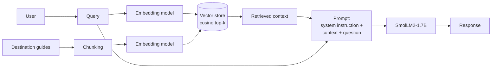
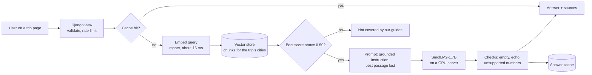

# A8: Semantic relationships and retrieval: analysis

TakeOff (Team 1) · INFO 490 · all numbers come from one run of `rag_system.ipynb` on an Apple Silicon Mac (MPS),
saved in `results/`.

## Contents

1. [System overview](#1-system-overview)
2. [Knowledge base and chunking](#2-knowledge-base-and-chunking)
3. [Evaluation table (Step 2.2)](#3-evaluation-table-step-22)
4. [Embedding models compared (Step 2.3)](#4-embedding-models-compared-step-23)
5. [Chunking strategies compared (Step 2.4)](#5-chunking-strategies-compared-step-24)
6. [Data scaling (Step 2.5)](#6-data-scaling-step-25)
7. [Failure analysis and root causes (Steps 3.1 and 3.2)](#7-failure-analysis-and-root-causes-steps-31-and-32)
8. [Improvements, before and after (Step 3.3)](#8-improvements-before-and-after-step-33)
9. [Cost awareness (Step 4.1)](#9-cost-awareness-step-41)
10. [RAG compared with fine-tuning and pure prompting (Step 4.2)](#10-rag-compared-with-fine-tuning-and-pure-prompting-step-42)
11. [System design for 10,000 users a day (Step 4.3)](#11-system-design-for-10000-users-a-day-step-43)
12. [Limits of this study](#12-limits-of-this-study)

## 1. System overview

| Part | Choice |
|---|---|
| Data | Destination guides for the 12 cities in TakeOff's destination list (40 paragraphs, 3,732 words) |
| Chunking | fixed length (100 words), overlapping paragraphs (2 paragraphs, stride 1), hybrid (one paragraph per chunk with a city/topic header) |
| Embedding models | small `all-MiniLM-L6-v2` (384 dims, 22.7M parameters), medium `all-mpnet-base-v2` (768, 109.5M), large `BAAI/bge-large-en-v1.5` (1024, 335.1M) |
| Vector store | L2-normalised NumPy matrix, cosine similarity by dot product, top-k = 3 |
| Generator | `HuggingFaceTB/SmolLM2-1.7B-Instruct`, greedy decoding, 120 new tokens, the same for every experiment |
| Why this generator | It is the model TakeOff already runs for day-by-day drafts. In our A6 benchmark it had the best itinerary score (0.758) and the fastest time per itinerary (3.2 s) of 15 models; A7 used the same figures for the routing design. |

Plain text version: User → Query → Embedding → Vector store → Retrieved context → LLM → Response.

## 2. Knowledge base and chunking

**Data.** One guide document per city (Chicago, New York, Rome, Florence, Venice, Milan, Tokyo, Kyoto, Osaka,
Lisbon, Porto, Reykjavik), written for this assignment from general travel knowledge, with the average daily cost
taken from TakeOff's destination table. 40 paragraphs, 80 to 121 words each (mean 93), 3,732 words in total. The
notebook asserts these limits. A second file of 19 paragraphs (TakeOff help pages and general travel advice) is used
only in the scaling test.

**How a paragraph is defined.** `## City, Country` starts a document, `### Topic` starts a section, and a paragraph
is a block of text between blank lines. Each paragraph gets an id such as `kyoto-1` (city plus position).

**Sentences.** A regex splits on `.`, `!` or `?` followed by a space and a capital letter or digit, with
abbreviations such as `St.` protected. Every strategy builds chunks only from whole sentences, and the notebook
checks that every sentence in every chunk exists unchanged in the source and that no chunk mixes two cities.

| Strategy | Rule | Chunks | Mean words |
|---|---|---|---|
| Fixed length | Sentences of one city document are packed into a chunk until the next sentence would pass 100 words. Topic boundaries inside a city are ignored, so 20 of the 40 paragraphs end up split across two chunks. | 44 | 85 |
| Overlapping paragraphs | Window of 2 paragraphs, stride 1, inside one city (paragraph 1+2, 2+3, ...). **Overlap:** every paragraph except a city's first and last is stored twice, so the overlap is one whole paragraph, about half of each chunk; total stored text is 5,168 words against 3,732. | 28 | 185 |
| Hybrid (section-aware) | One chunk per paragraph (one topic), prefixed with a header `City, Country / Topic:` so a paragraph that never names its city still carries it. Paragraphs over 150 words would be split at a sentence boundary (none are). | 40 | 100 |

## 3. Evaluation table (Step 2.2)

Eight test questions (Step 2.1), each with its gold paragraph(s) and the facts a correct answer needs:

| Id | Query | correct | partial | wrong |
|---|---|---|---|---|
| Q1 | How do I get from the airport to Kyoto? | 2 | 7 | 0 |
| Q2 | What local food should I try in Lisbon? | 3 | 4 | 2 |
| Q3 | Will Venice be flooded if I visit in November? | 3 | 3 | 3 |
| Q4 | Do I need to book the Last Supper in Milan ahead of time? | 8 | 1 | 0 |
| Q5 | Can I see the northern lights on a July trip to Reykjavik? | 0 | 9 | 0 |
| Q6 | What is a cheap way to ride the subway a lot in New York? | 1 | 1 | 7 |
| Q7 | Which is cheaper per day, Lisbon or Porto? | 3 | 0 | 6 |
| Q8 | Where can I see free-roaming deer on a day trip from Osaka? | 4 | 5 | 0 |

The verdict columns above are our manual review (below). Q1 is tricky (Kyoto has no airport), Q5 needs a "no", Q7
needs two documents and Q8 never names the place that answers it (Nara).

**How the columns are scored.**

* *Context quality* (script): 1 + 9 × share of required facts present in the retrieved chunks.
* *Answer quality* (script): 1 + 9 × share of required facts present in the answer.
* *Manual verdict*: we read all 72 answers. **correct** = answers from the retrieved facts only; **partial** = core
  answer right but with an added detail that is wrong or not in the guides; **wrong** = wrong, contradicts the
  context, or built on invented facts. Points: 1, 0.5, 0. Labels and reasons are in `results/manual_review.csv`.

The script score turned out to be too lenient. Context quality is 10 in every row, because the gold paragraph was
always retrieved. On Q7 all nine answers contain "85" and "95" and score 10, but six of them say Lisbon is the
cheaper city. So the conclusions below rely on the manual verdicts, with the script score shown for reference.

**Summary per configuration** (8 questions each):

| Embedding | Chunking | Gold paragraph in top 3 | Context quality (script) | Answer quality (script) | Manual: correct / partial / wrong | Manual points (of 8) | Retrieval ms (median) | Generation s (mean) | Prompt tokens |
|---|---|---|---|---|---|---|---|---|---|
| MiniLM-L6 (384) | fixed | 8/8 | 10.0 | 6.06 | 1 / 5 / 2 | 3.5 | 13.6 | 3.04 | 466 |
| MiniLM-L6 (384) | overlap | 8/8 | 10.0 | 6.62 | 1 / 4 / 3 | 3 | 5.2 | 3.97 | 859 |
| MiniLM-L6 (384) | hybrid | 8/8 | 10.0 | 5.5 | 2 / 3 / 3 | 3.5 | 9.6 | 2.42 | 502 |
| mpnet-base (768) | fixed | 8/8 | 10.0 | 7.75 | 5 / 1 / 2 | 5.5 | 15.8 | 2.84 | 450 |
| mpnet-base (768) | overlap | 8/8 | 10.0 | 7.19 | 2 / 3 / 3 | 3.5 | 10 | 4.01 | 845 |
| mpnet-base (768) | hybrid | 8/8 | 10.0 | 6.62 | 4 / 3 / 1 | 5.5 | 18.2 | 2.6 | 505 |
| bge-large (1024) | fixed | 8/8 | 10.0 | 8.88 | 5 / 3 / 0 | 6.5 | 38.4 | 2.88 | 448 |
| bge-large (1024) | overlap | 8/8 | 10.0 | 7.75 | 0 / 6 / 2 | 3 | 27.4 | 3.74 | 848 |
| bge-large (1024) | hybrid | 8/8 | 10.0 | 5.5 | 4 / 2 / 2 | 5 | 27.1 | 2.26 | 505 |

**Full table: every configuration × every query.** Retrieved chunk ids, the paragraphs they cover and their cosine
score are listed for each row; the full text of every retrieved chunk is printed in the notebook (Step 2.2, second
cell) and saved in the `retrieved_text` column of `results/evaluation_table.csv`.

| Embedding | Chunking | Query | Retrieved chunks (paragraphs, score) | Context quality | Answer quality (script) | Manual verdict | Latency (search ms + generation s) | Notes |
|---|---|---|---|---|---|---|---|---|
| small | fixed | Q1 | fixed-28['kyoto-1'] 0.74 / fixed-31['osaka-1'] 0.64 / fixed-23['tokyo-1'] 0.52 | 10 | 10 | partial | 24 ms + 5.5 s | Haruka route correct; invents a flight to 'Kyoto's Itami Airport' (Itami serves Osaka; Kyoto has no airport) |
| small | fixed | Q2 | fixed-36['lisbon-3'] 0.62 / fixed-39['porto-3'] 0.52 / fixed-34['lisbon-1'] 0.46 | 10 | 1 | partial | 14 ms + 3.1 s | Pastel de nata correct; francesinha is Porto's dish (from the Porto chunk); 'funicular rides' is not food |
| small | fixed | Q3 | fixed-19['venice-3'] 0.68 / fixed-16['venice-1'] 0.46 / fixed-10['rome-2', 'rome-3'] 0.40 | 10 | 5.5 | partial | 5 ms + 3.4 s | Acqua alta correct; invents that November floods less than September and October |
| small | fixed | Q4 | fixed-21['milan-2', 'milan-3'] 0.55 / fixed-22['milan-3'] 0.39 / fixed-9['rome-1', 'rome-2'] 0.38 | 10 | 5.5 | correct | 16 ms + 1.9 s | Yes, book ahead (timed slots that sell out) |
| small | fixed | Q5 | fixed-42['reykjavik-3'] 0.77 / fixed-40['reykjavik-1'] 0.42 / fixed-41['reykjavik-2'] 0.37 | 10 | 10 | partial | 16 ms + 2.4 s | Correct 'no'; gives the season as late August to April (guide: September to April) |
| small | fixed | Q6 | fixed-4['new-york-1'] 0.61 / fixed-7['new-york-4'] 0.52 / fixed-6['new-york-2', 'new-york-3'] 0.50 | 10 | 1 | wrong | 11 ms + 3.1 s | MetroCard at $33 and $127, none of it in the guide; misses the OMNY 12-ride cap |
| small | fixed | Q7 | fixed-36['lisbon-3'] 0.63 / fixed-39['porto-3'] 0.60 / fixed-34['lisbon-1'] 0.51 | 10 | 10 | wrong | 11 ms + 2.7 s | Says Lisbon is cheaper while quoting Lisbon $95 and Porto $85 |
| small | fixed | Q8 | fixed-33['osaka-3'] 0.57 / fixed-31['osaka-1'] 0.43 / fixed-26['tokyo-3', 'tokyo-4'] 0.39 | 10 | 5.5 | partial | 13 ms + 2.2 s | Nara correct; says Nara is reached by the airport trains (Rapi:t, Haruka) |
| small | overlap | Q1 | overlap-17['kyoto-1', 'kyoto-2'] 0.71 / overlap-14['tokyo-1', 'tokyo-2'] 0.52 / overlap-19['osaka-1', 'osaka-2'] 0.51 | 10 | 10 | partial | 11 ms + 5.4 s | Haruka correct; wrongly says the Rapi:t goes to Tennoji and connects to the Haruka |
| small | overlap | Q2 | overlap-22['lisbon-2', 'lisbon-3'] 0.65 / overlap-24['porto-2', 'porto-3'] 0.55 / overlap-21['lisbon-1', 'lisbon-2'] 0.50 | 10 | 1 | wrong | 5 ms + 5.0 s | Invents 'bica de caldo verde, a black pudding'; lists Porto's francesinha and tripas as Lisbon food |
| small | overlap | Q3 | overlap-10['venice-1', 'venice-2'] 0.50 / overlap-11['venice-2', 'venice-3'] 0.48 / overlap-6['rome-2', 'rome-3'] 0.42 | 10 | 5.5 | partial | 10 ms + 3.7 s | High tides correct; invents a September-November season and omits MOSE |
| small | overlap | Q4 | overlap-13['milan-2', 'milan-3'] 0.52 / overlap-12['milan-1', 'milan-2'] 0.50 / overlap-5['rome-1', 'rome-2'] 0.39 | 10 | 10 | correct | 5 ms + 2.7 s | Yes, book ahead (timed slots that sell out) |
| small | overlap | Q5 | overlap-26['reykjavik-2', 'reykjavik-3'] 0.67 / overlap-27['reykjavik-3', 'reykjavik-4'] 0.55 / overlap-25['reykjavik-1', 'reykjavik-2'] 0.52 | 10 | 10 | partial | 6 ms + 3.5 s | Correct 'no' and September-April season; wrong reason ('short days': July has the midnight sun) |
| small | overlap | Q6 | overlap-2['new-york-1', 'new-york-2'] 0.59 / overlap-4['new-york-3', 'new-york-4'] 0.56 / overlap-3['new-york-2', 'new-york-3'] 0.49 | 10 | 1 | wrong | 5 ms + 4.4 s | MetroCard refills and a 7-day pass, not in the guide; misses the OMNY cap |
| small | overlap | Q7 | overlap-22['lisbon-2', 'lisbon-3'] 0.61 / overlap-24['porto-2', 'porto-3'] 0.60 / overlap-21['lisbon-1', 'lisbon-2'] 0.49 | 10 | 10 | wrong | 5 ms + 3.3 s | Says Lisbon is cheaper while quoting Lisbon $95 and Porto $85 |
| small | overlap | Q8 | overlap-20['osaka-2', 'osaka-3'] 0.46 / overlap-19['osaka-1', 'osaka-2'] 0.40 / overlap-14['tokyo-1', 'tokyo-2'] 0.39 | 10 | 5.5 | partial | 5 ms + 3.7 s | Nara correct; says Nara is reached by the airport trains (Rapi:t, Haruka) |
| small | hybrid | Q1 | hybrid-24['kyoto-1'] 0.74 / hybrid-27['osaka-1'] 0.63 / hybrid-26['kyoto-3'] 0.57 | 10 | 10 | partial | 7 ms + 3.1 s | Haruka correct; adds car hire and taxis, which the guide does not mention |
| small | hybrid | Q2 | hybrid-32['lisbon-3'] 0.66 / hybrid-35['porto-3'] 0.54 / hybrid-31['lisbon-2'] 0.51 | 10 | 1 | partial | 5 ms + 3.1 s | Pastel de nata correct; francesinha belongs to Porto |
| small | hybrid | Q3 | hybrid-16['venice-3'] 0.60 / hybrid-15['venice-2'] 0.51 / hybrid-14['venice-1'] 0.47 | 10 | 1 | wrong | 10 ms + 1.2 s | 'No, Venice will not be flooded', although the chunk says acqua alta happens from autumn to early spring |
| small | hybrid | Q4 | hybrid-18['milan-2'] 0.51 / hybrid-19['milan-3'] 0.45 / hybrid-8['rome-2'] 0.40 | 10 | 5.5 | correct | 10 ms + 2.0 s | Yes, book ahead (timed slots that sell out) |
| small | hybrid | Q5 | hybrid-38['reykjavik-3'] 0.77 / hybrid-37['reykjavik-2'] 0.57 / hybrid-36['reykjavik-1'] 0.42 | 10 | 5.5 | partial | 11 ms + 2.0 s | Correct 'no'; wrong reason: says short daylight, when July has almost 24 hours of it |
| small | hybrid | Q6 | hybrid-3['new-york-1'] 0.64 / hybrid-6['new-york-4'] 0.55 / hybrid-5['new-york-3'] 0.46 | 10 | 1 | wrong | 10 ms + 3.0 s | Unlimited MetroCard, not in the guide; misses the OMNY cap |
| small | hybrid | Q7 | hybrid-32['lisbon-3'] 0.69 / hybrid-35['porto-3'] 0.65 / hybrid-30['lisbon-1'] 0.53 | 10 | 10 | wrong | 11 ms + 2.7 s | Says Lisbon is cheaper while quoting Lisbon $95 and Porto $85 |
| small | hybrid | Q8 | hybrid-29['osaka-3'] 0.58 / hybrid-21['tokyo-2'] 0.43 / hybrid-27['osaka-1'] 0.43 | 10 | 10 | correct | 5 ms + 2.2 s | Nara Park and its free-roaming deer |
| medium | fixed | Q1 | fixed-28['kyoto-1'] 0.75 / fixed-31['osaka-1'] 0.62 / fixed-30['kyoto-3'] 0.54 | 10 | 10 | correct | 20 ms + 4.6 s | Haruka 75-80 min and shinkansen from Tokyo, all from the guide |
| medium | fixed | Q2 | fixed-36['lisbon-3'] 0.63 / fixed-39['porto-3'] 0.61 / fixed-35['lisbon-2'] 0.52 | 10 | 5.5 | correct | 29 ms + 2.7 s | Pastel de nata and bifana, both from the Lisbon guide |
| medium | fixed | Q3 | fixed-19['venice-3'] 0.70 / fixed-16['venice-1'] 0.47 / fixed-18['venice-2', 'venice-3'] 0.42 | 10 | 10 | correct | 13 ms + 3.1 s | Acqua alta from autumn to spring, MOSE barriers, warning sirens |
| medium | fixed | Q4 | fixed-21['milan-2', 'milan-3'] 0.57 / fixed-9['rome-1', 'rome-2'] 0.48 / fixed-22['milan-3'] 0.45 | 10 | 5.5 | correct | 16 ms + 1.9 s | Yes, book ahead (timed slots that sell out) |
| medium | fixed | Q5 | fixed-42['reykjavik-3'] 0.76 / fixed-41['reykjavik-2'] 0.41 / fixed-40['reykjavik-1'] 0.41 | 10 | 10 | partial | 13 ms + 2.3 s | Correct 'no'; gives the season as late August to April (guide: September to April) |
| medium | fixed | Q6 | fixed-4['new-york-1'] 0.65 / fixed-6['new-york-2', 'new-york-3'] 0.50 / fixed-7['new-york-4'] 0.48 | 10 | 1 | wrong | 15 ms + 3.1 s | MetroCard at $33 and $127, none of it in the guide; misses the OMNY 12-ride cap |
| medium | fixed | Q7 | fixed-39['porto-3'] 0.57 / fixed-36['lisbon-3'] 0.53 / fixed-34['lisbon-1'] 0.47 | 10 | 10 | wrong | 22 ms + 2.5 s | Says Lisbon is cheaper and swaps the prices (Lisbon $85, Porto $95) |
| medium | fixed | Q8 | fixed-33['osaka-3'] 0.50 / fixed-30['kyoto-3'] 0.40 / fixed-29['kyoto-2', 'kyoto-3'] 0.40 | 10 | 10 | correct | 11 ms + 2.6 s | Nara Park and its free-roaming deer |
| medium | overlap | Q1 | overlap-17['kyoto-1', 'kyoto-2'] 0.69 / overlap-18['kyoto-2', 'kyoto-3'] 0.52 / overlap-14['tokyo-1', 'tokyo-2'] 0.50 | 10 | 10 | partial | 13 ms + 5.3 s | Haruka correct; invents shinkansen times from Narita and Haneda |
| medium | overlap | Q2 | overlap-22['lisbon-2', 'lisbon-3'] 0.63 / overlap-24['porto-2', 'porto-3'] 0.61 / overlap-21['lisbon-1', 'lisbon-2'] 0.52 | 10 | 1 | wrong | 10 ms + 5.0 s | Invents 'bica de caldo verde, a black pudding'; lists Porto's francesinha and tripas as Lisbon food |
| medium | overlap | Q3 | overlap-11['venice-2', 'venice-3'] 0.55 / overlap-10['venice-1', 'venice-2'] 0.50 / overlap-7['rome-3', 'rome-4'] 0.39 | 10 | 10 | correct | 10 ms + 4.0 s | Acqua alta likely in November, MOSE protection |
| medium | overlap | Q4 | overlap-13['milan-2', 'milan-3'] 0.57 / overlap-12['milan-1', 'milan-2'] 0.50 / overlap-6['rome-2', 'rome-3'] 0.46 | 10 | 5.5 | correct | 10 ms + 2.7 s | Yes, book ahead (timed slots that sell out) |
| medium | overlap | Q5 | overlap-26['reykjavik-2', 'reykjavik-3'] 0.68 / overlap-27['reykjavik-3', 'reykjavik-4'] 0.63 / overlap-25['reykjavik-1', 'reykjavik-2'] 0.49 | 10 | 10 | partial | 10 ms + 3.5 s | Correct 'no' and September-April season; wrong reason ('short days': July has the midnight sun) |
| medium | overlap | Q6 | overlap-2['new-york-1', 'new-york-2'] 0.64 / overlap-4['new-york-3', 'new-york-4'] 0.52 / overlap-3['new-york-2', 'new-york-3'] 0.51 | 10 | 1 | wrong | 10 ms + 4.3 s | MetroCard refills and a 7-day pass, not in the guide; misses the OMNY cap |
| medium | overlap | Q7 | overlap-24['porto-2', 'porto-3'] 0.55 / overlap-22['lisbon-2', 'lisbon-3'] 0.50 / overlap-21['lisbon-1', 'lisbon-2'] 0.46 | 10 | 10 | wrong | 10 ms + 3.1 s | Says Lisbon is cheaper and swaps the prices (Lisbon $85, Porto $95) |
| medium | overlap | Q8 | overlap-20['osaka-2', 'osaka-3'] 0.47 / overlap-17['kyoto-1', 'kyoto-2'] 0.42 / overlap-18['kyoto-2', 'kyoto-3'] 0.40 | 10 | 10 | partial | 10 ms + 4.1 s | Nara correct; 'an hour away' (guide: 45 minutes) and 'locals feed them' are not in the guide |
| medium | hybrid | Q1 | hybrid-24['kyoto-1'] 0.80 / hybrid-27['osaka-1'] 0.65 / hybrid-25['kyoto-2'] 0.57 | 10 | 10 | partial | 19 ms + 4.5 s | Haruka correct; adds car hire and taxis, which the guide does not mention |
| medium | hybrid | Q2 | hybrid-32['lisbon-3'] 0.69 / hybrid-31['lisbon-2'] 0.61 / hybrid-35['porto-3'] 0.60 | 10 | 1 | correct | 19 ms + 2.3 s | Pastel de nata only: correct but incomplete |
| medium | hybrid | Q3 | hybrid-16['venice-3'] 0.59 / hybrid-15['venice-2'] 0.48 / hybrid-14['venice-1'] 0.47 | 10 | 1 | wrong | 16 ms + 1.3 s | 'No, Venice will not be flooded', although the chunk says acqua alta happens from autumn to early spring |
| medium | hybrid | Q4 | hybrid-8['rome-2'] 0.49 / hybrid-18['milan-2'] 0.46 / hybrid-19['milan-3'] 0.44 | 10 | 5.5 | correct | 18 ms + 2.0 s | Yes, book ahead (timed slots that sell out) |
| medium | hybrid | Q5 | hybrid-38['reykjavik-3'] 0.78 / hybrid-37['reykjavik-2'] 0.52 / hybrid-36['reykjavik-1'] 0.42 | 10 | 5.5 | partial | 18 ms + 2.1 s | Correct 'no'; wrong reason: says short daylight, when July has almost 24 hours of it |
| medium | hybrid | Q6 | hybrid-3['new-york-1'] 0.69 / hybrid-6['new-york-4'] 0.52 / hybrid-0['chicago-1'] 0.47 | 10 | 10 | partial | 23 ms + 4.1 s | OMNY and free rides after 12 paid rides correct; muddles it into 'unlimited rides for 7 days' |
| medium | hybrid | Q7 | hybrid-35['porto-3'] 0.63 / hybrid-32['lisbon-3'] 0.61 / hybrid-33['porto-1'] 0.54 | 10 | 10 | correct | 18 ms + 2.6 s | Porto is cheaper: $85 against $95 |
| medium | hybrid | Q8 | hybrid-29['osaka-3'] 0.54 / hybrid-25['kyoto-2'] 0.46 / hybrid-27['osaka-1'] 0.44 | 10 | 10 | correct | 18 ms + 1.9 s | Nara Park and its free-roaming deer |
| large | fixed | Q1 | fixed-28['kyoto-1'] 0.81 / fixed-31['osaka-1'] 0.67 / fixed-30['kyoto-3'] 0.64 | 10 | 10 | correct | 46 ms + 4.6 s | Haruka 75-80 min and shinkansen from Tokyo, all from the guide |
| large | fixed | Q2 | fixed-36['lisbon-3'] 0.72 / fixed-35['lisbon-2'] 0.64 / fixed-18['venice-2', 'venice-3'] 0.62 | 10 | 5.5 | partial | 38 ms + 2.5 s | Nata and bifana correct; 'sweet-and-sour sardines' is Venice's sarde in saor from the Venice chunk |
| large | fixed | Q3 | fixed-19['venice-3'] 0.72 / fixed-16['venice-1'] 0.60 / fixed-18['venice-2', 'venice-3'] 0.58 | 10 | 10 | correct | 39 ms + 3.0 s | Acqua alta from autumn to spring, MOSE barriers, warning sirens |
| large | fixed | Q4 | fixed-21['milan-2', 'milan-3'] 0.70 / fixed-9['rome-1', 'rome-2'] 0.69 / fixed-22['milan-3'] 0.61 | 10 | 5.5 | correct | 43 ms + 1.9 s | Yes, book ahead (timed slots that sell out) |
| large | fixed | Q5 | fixed-42['reykjavik-3'] 0.76 / fixed-40['reykjavik-1'] 0.59 / fixed-41['reykjavik-2'] 0.57 | 10 | 10 | partial | 27 ms + 2.3 s | Correct 'no'; gives the season as late August to April (guide: September to April) |
| large | fixed | Q6 | fixed-4['new-york-1'] 0.70 / fixed-6['new-york-2', 'new-york-3'] 0.62 / fixed-16['venice-1'] 0.62 | 10 | 10 | correct | 27 ms + 3.4 s | Tap OMNY or a contactless card; free after 12 paid rides in seven days |
| large | fixed | Q7 | fixed-39['porto-3'] 0.68 / fixed-36['lisbon-3'] 0.68 / fixed-37['porto-1'] 0.63 | 10 | 10 | correct | 42 ms + 2.4 s | Porto is cheaper: $85 against $95 |
| large | fixed | Q8 | fixed-33['osaka-3'] 0.71 / fixed-31['osaka-1'] 0.58 / fixed-29['kyoto-2', 'kyoto-3'] 0.58 | 10 | 10 | partial | 27 ms + 3.0 s | Nara correct; says Nara is reached by the airport trains (Rapi:t, Haruka) |
| large | overlap | Q1 | overlap-17['kyoto-1', 'kyoto-2'] 0.78 / overlap-19['osaka-1', 'osaka-2'] 0.64 / overlap-18['kyoto-2', 'kyoto-3'] 0.61 | 10 | 10 | partial | 28 ms + 5.5 s | Haruka correct; invents a shinkansen from Kansai airport and a 2h15-2h45 total |
| large | overlap | Q2 | overlap-22['lisbon-2', 'lisbon-3'] 0.70 / overlap-21['lisbon-1', 'lisbon-2'] 0.65 / overlap-24['porto-2', 'porto-3'] 0.60 | 10 | 5.5 | partial | 27 ms + 2.5 s | Pastel de nata correct; bica coffee is not in the guide |
| large | overlap | Q3 | overlap-11['venice-2', 'venice-3'] 0.64 / overlap-10['venice-1', 'venice-2'] 0.63 / overlap-6['rome-2', 'rome-3'] 0.55 | 10 | 5.5 | partial | 40 ms + 3.9 s | Acqua alta correct; invents lower-risk shoulder seasons |
| large | overlap | Q4 | overlap-12['milan-1', 'milan-2'] 0.68 / overlap-13['milan-2', 'milan-3'] 0.68 / overlap-6['rome-2', 'rome-3'] 0.62 | 10 | 10 | partial | 40 ms + 3.3 s | Opens with 'No, you do not necessarily need to book', then says to book ahead |
| large | overlap | Q5 | overlap-27['reykjavik-3', 'reykjavik-4'] 0.71 / overlap-26['reykjavik-2', 'reykjavik-3'] 0.70 / overlap-25['reykjavik-1', 'reykjavik-2'] 0.62 | 10 | 10 | partial | 27 ms + 3.5 s | Correct 'no' and September-April season; wrong reason ('short days': July has the midnight sun) |
| large | overlap | Q6 | overlap-2['new-york-1', 'new-york-2'] 0.71 / overlap-3['new-york-2', 'new-york-3'] 0.66 / overlap-4['new-york-3', 'new-york-4'] 0.65 | 10 | 1 | wrong | 27 ms + 4.1 s | MetroCard and cheaper off-peak buses, not in the guide |
| large | overlap | Q7 | overlap-24['porto-2', 'porto-3'] 0.68 / overlap-22['lisbon-2', 'lisbon-3'] 0.66 / overlap-21['lisbon-1', 'lisbon-2'] 0.63 | 10 | 10 | wrong | 27 ms + 3.2 s | Says Lisbon is cheaper and swaps the prices (Lisbon $85, Porto $95) |
| large | overlap | Q8 | overlap-20['osaka-2', 'osaka-3'] 0.65 / overlap-19['osaka-1', 'osaka-2'] 0.61 / overlap-18['kyoto-2', 'kyoto-3'] 0.59 | 10 | 10 | partial | 28 ms + 3.9 s | Nara correct; says it is reached 'via Kansai International Airport' |
| large | hybrid | Q1 | hybrid-24['kyoto-1'] 0.81 / hybrid-27['osaka-1'] 0.67 / hybrid-26['kyoto-3'] 0.63 | 10 | 10 | partial | 27 ms + 3.1 s | Haruka correct; adds car hire and taxis, which the guide does not mention |
| large | hybrid | Q2 | hybrid-32['lisbon-3'] 0.70 / hybrid-31['lisbon-2'] 0.66 / hybrid-35['porto-3'] 0.61 | 10 | 1 | correct | 27 ms + 2.2 s | Pastel de nata only: correct but incomplete |
| large | hybrid | Q3 | hybrid-16['venice-3'] 0.65 / hybrid-14['venice-1'] 0.61 / hybrid-15['venice-2'] 0.56 | 10 | 1 | wrong | 26 ms + 1.2 s | 'No, Venice will not be flooded', although the chunk says acqua alta happens from autumn to early spring |
| large | hybrid | Q4 | hybrid-18['milan-2'] 0.64 / hybrid-19['milan-3'] 0.61 / hybrid-8['rome-2'] 0.60 | 10 | 5.5 | correct | 26 ms + 2.0 s | Yes, book ahead (timed slots that sell out) |
| large | hybrid | Q5 | hybrid-38['reykjavik-3'] 0.75 / hybrid-37['reykjavik-2'] 0.59 / hybrid-36['reykjavik-1'] 0.57 | 10 | 5.5 | partial | 27 ms + 2.0 s | Correct 'no'; wrong reason: says short daylight, when July has almost 24 hours of it |
| large | hybrid | Q6 | hybrid-3['new-york-1'] 0.73 / hybrid-0['chicago-1'] 0.61 / hybrid-6['new-york-4'] 0.60 | 10 | 1 | wrong | 27 ms + 3.2 s | Unlimited MetroCard for $33, not in the guide |
| large | hybrid | Q7 | hybrid-35['porto-3'] 0.69 / hybrid-32['lisbon-3'] 0.66 / hybrid-33['porto-1'] 0.63 | 10 | 10 | correct | 27 ms + 2.5 s | Porto is cheaper: $85 against $95 |
| large | hybrid | Q8 | hybrid-29['osaka-3'] 0.71 / hybrid-27['osaka-1'] 0.58 / hybrid-25['kyoto-2'] 0.57 | 10 | 10 | correct | 27 ms + 1.9 s | Nara Park and its free-roaming deer |

## 4. Embedding models compared (Step 2.3)

| Embedding model | Parameters (M) | Gold in top 3 | Mean top-1 score | Mean margin gold vs best other | Manual points (of 24) | Correct | Wrong | Answer quality (script) | Query search ms (median) | Embed ms per chunk (hybrid) |
|---|---|---|---|---|---|---|---|---|---|---|
| MiniLM-L6 (384) | 22.7 | 24/24 | 0.646 | 0.159 | 10 | 4 | 8 | 6.06 | 10 | 2.3 |
| mpnet-base (768) | 109.5 | 24/24 | 0.641 | 0.147 | 14.5 | 11 | 6 | 7.19 | 15.5 | 14.9 |
| bge-large (1024) | 335.1 | 24/24 | 0.725 | 0.099 | 14.5 | 9 | 4 | 7.38 | 27.2 | 45.4 |

**How did embedding size affect retrieval quality?** It did not change whether the right paragraph was found: all
three models put the gold paragraph in the top 3 for all 24 of their rows, and at rank 1 in 70 of the 72 rows
(retrieval depth table in the notebook: hit@1 is 7 or 8 of 8 for every configuration). The knowledge base is small
and most questions name their city, so this task does not separate the models. What did change is the shape of the
scores. The large BGE model gives higher scores to everything (mean top-1 0.725 against about 0.64), but the gap
between the right chunk and the best wrong one is smaller (mean margin 0.099 against 0.147 for mpnet and 0.159 for
MiniLM). A high BGE score therefore means less on its own, which matters when a score threshold is used (section 8).

**How did it affect answer quality?** Through the second and third retrieved chunks. With the gold chunk always at
rank 1, the models differed in which neighbouring chunks filled slots 2 and 3, and the generator often borrowed
from those. MiniLM put another city's chunk on the same topic in slots 2 to 3 more often (for Q2 its top 3 included
Porto's food paragraph in all three chunking strategies), and it scored lowest: 10 of 24 points against 14.5 for
both mpnet and bge.

**Did larger embeddings always perform better?** No. The large model tied the medium one on manual points (14.5
each), and large/overlap (3.0 of 8) was among the worst configurations of all. The single best configuration was
large/fixed (6.5 of 8, no wrong answers), but medium/fixed and medium/hybrid were close behind (5.5). The large
model costs about three times more: 335M parameters against 110M, a median query search time of 27 ms against 16 ms,
and about 45 ms per hybrid chunk to embed against 15 ms. On this data the medium model gave the same answer quality for a
third of the cost.

## 5. Chunking strategies compared (Step 2.4)

| Chunking | Chunks | Mean words per chunk | Manual points (of 24) | Correct | Wrong | Answer quality (script) | Prompt tokens (k=3) | Generation s |
|---|---|---|---|---|---|---|---|---|
| fixed | 44 | 85 | 15.5 | 11 | 4 | 7.56 | 454 | 2.92 |
| overlap | 28 | 185 | 9.5 | 3 | 8 | 7.19 | 851 | 3.91 |
| hybrid | 40 | 100 | 14 | 10 | 6 | 5.88 | 504 | 2.43 |

**Which strategy worked better, and why?** Fixed length and hybrid were close (15.5 and 14.0 of 24 points);
overlapping paragraphs was clearly worst (9.5, with 8 wrong answers out of 24). Overlap chunks are two paragraphs
long, so three of them fill the prompt with about 850 tokens instead of about 450 to 500, most of it about other
topics. The generator then mixes those topics in: the two "black pudding" answers for Lisbon food and three of the
seven MetroCard answers came from overlap configurations. Fixed and hybrid differ on one question: fixed-length
chunking happened to start a chunk exactly at Venice's flooding sentence, while hybrid kept the whole mixed-topic
paragraph together, and all three hybrid configurations answered "No, Venice will not be flooded" (failure 1).

**How did chunking affect retrieval relevance?** Not the gold hit rate (100% for all three), but the precision of
what was retrieved. An overlap chunk is at most half gold paragraph, and a fixed chunk can mix the end of one topic
with the start of the next (20 of 40 paragraphs are split). Hybrid chunks are one topic each, and the city header
ties each chunk to its city even when the paragraph never names it.

**How did it affect the final answers?** Mostly through the amount of unrelated text the model sees. Longer chunks
gave the 1.7B generator more material to borrow from, and it did; whole-paragraph chunks could hide a fact behind
unrelated sentences. Both point to short, single-topic chunks, which is what round 2 of the improvements tested.

**Latency.** Generation dominated every row: 1.2 to 5.5 seconds per answer (2.3 to 4.0 s averaged per
configuration), against 5 to 46 ms for embedding the query and searching (medians 10, 16 and 27 ms by model). Overlap was the slowest strategy (3.91 s mean generation against 2.92 for fixed and 2.43 for hybrid)
because of its longer prompts and answers.

## 6. Data scaling (Step 2.5)

Configuration used for the answers: large/fixed (best mean script score in Step 2.2, picked by code). Retrieval was
measured for all three models.

| Dataset | Content | Paragraphs | Words |
|---|---|---|---|
| Small | 5 cities (Tokyo, Kyoto, Osaka, Lisbon, Porto); only Q1, Q2, Q7, Q8 can be answered | 16 | 1,445 |
| Base | all 12 cities | 40 | 3,732 |
| Large | base + 19 help and general-advice paragraphs | 59 | 5,441 |

| Dataset | Embedding | Gold hit rate | Off-topic chunks in top 3 | Chunks from the extra documents | Mean margin | Mean top-1 score |
|---|---|---|---|---|---|---|
| small | MiniLM-L6 (384) | 0.5 | 2 | 0 | 0.116 | 0.457 |
| small | mpnet-base (768) | 0.5 | 2 | 0 | 0.087 | 0.451 |
| small | bge-large (1024) | 0.5 | 1.88 | 0 | 0.101 | 0.636 |
| base | MiniLM-L6 (384) | 1 | 0.75 | 0 | 0.159 | 0.646 |
| base | mpnet-base (768) | 1 | 0.62 | 0 | 0.147 | 0.641 |
| base | bge-large (1024) | 1 | 0.62 | 0 | 0.099 | 0.725 |
| large | MiniLM-L6 (384) | 1 | 0.75 | 0 | 0.159 | 0.646 |
| large | mpnet-base (768) | 1 | 0.62 | 0 | 0.147 | 0.641 |
| large | bge-large (1024) | 1 | 0.75 | 0.12 | 0.099 | 0.725 |

**How does dataset size affect retrieval quality?** Going from base to large (+45% text) changed almost nothing:
the gold hit rate stayed at 100% for every model, and only one extra-document chunk reached a top 3 (for the large
model, "Trains in Italy" at rank 3 for the Milan question, where its margin fell to 0.017). Unrelated documents
(TakeOff help pages, passports, insurance) never competed; near-topic ones (Italian trains for a Milan question) did.
Going down to the small subset removed the answer for four questions, and retrieval then returned three unrelated
chunks for each of them, as it always will: top-k never returns nothing.

**How does it affect noise?** Noise came from missing data, not from extra data. With the answer missing, the top-1
scores dropped (unanswerable questions scored at most 0.39 with MiniLM and
0.37 with mpnet, against at least 0.57 and
0.5 for answerable ones; BGE's 0.55 against
0.68 is a narrower gap), but the generator still answered every question and did
not say it did not know. Two of the four answers were invented from noise:

* Q4 (Last Supper, no Milan guide): *"No, there is no need to book the Last Supper in Milan ahead of time. It is an open restaurant where customers can enjoy their meals without reservations."*
* Q6 (New York subway, no New York guide), with Lisbon's transport chunk retrieved: *"In New York City, a cheap way to ride the subway a lot is by purchasing a MetroCard, which can be refilled at any subway station. You can also use a rechargeable Viva Viagem card, which works on most ..."*

The instruction "say that you do not know" is not enough for a 1.7B model. A retrieval score threshold is needed so
that weak matches never reach the generator; section 8 calibrates one.

## 7. Failure analysis and root causes (Steps 3.1 and 3.2)

The notebook flags every row where retrieval missed, where the answer lost facts that were in the context, or where
the answer has numbers the context does not (Step 3.1 cell). Reading all 72 answers gave 24 correct, 30 partial and
18 wrong. The four failures below are the clearest; each is shown with its retrieved chunks.

### Failure 1: correct chunk retrieved, wrong answer, because of chunking (Q3, all three hybrid configurations)

Question: *Will Venice be flooded if I visit in November?* Retrieved (medium/hybrid): `hybrid-16['venice-3'] 0.59 | hybrid-15['venice-2'] 0.48 | hybrid-14['venice-1'] 0.47`

> [hybrid-16] Venice, Italy / Food, seasons and costs: Venetians snack on cicchetti, small bites served in wine bars called bacari, usually with a glass of wine or a spritz. Local dishes include sarde in saor, sweet-and-sour sardines, and risotto made black with squid ink. From autumn to early spring, high tides called acqua alta can flood low areas such as St. Mark's Square; the MOSE flood barriers now protect the ...
>
> [hybrid-15] Venice, Italy / Sights and islands: St. Mark's Basilica and the Doge's Palace face St. Mark's Square, and both are busiest in the late morning. The Rialto Bridge and its market are a short walk away. Murano is known for glassblowing and Burano for its brightly painted houses and lace; both are reached by vaporetto and make an easy half-day trip. On certain peak days in spring and summer, day visitors who ...
>
> [hybrid-14] Venice, Italy / Getting around: Venice has no cars; people travel on foot or by water. Vaporetto water buses run along the Grand Canal and out to the islands, and passes for one, two, three or seven days are cheaper than buying several single tickets. The traghetto, a gondola ferry that crosses the Grand Canal at a few points, is a cheap way to ride a gondola briefly. Private gondola rides follow an ...

Answer: **"No, Venice will not be flooded if you visit in November."**

The fact is in the top chunk, but in the middle of a paragraph whose header and first two sentences are about food.
With fixed-length chunks the same paragraph is cut so that a chunk starts with "From autumn to early spring, high
tides called acqua alta can flood...", for example medium/fixed:
*"Venice may experience flooding due to high tides called acqua alta, especially during autumn to early spring. However, the MOSE flood barriers have been installed to protect the city from the worst tides, and there are w..."* (all three fixed configurations explained acqua alta; two were fully correct).

**Root cause: chunking.** Not the embedding model (all three ranked the right paragraph first) and not the query.
The guide paragraph mixes food, flooding, winter and cost; a whole-paragraph chunk buries the fact, and the small
generator answers a yes/no question from the first lines.

### Failure 2: facts borrowed from another city (Q2, Lisbon food)

Question: *What local food should I try in Lisbon?* Retrieved (small/hybrid): `hybrid-32['lisbon-3'] 0.66 | hybrid-35['porto-3'] 0.54 | hybrid-31['lisbon-2'] 0.51`

Answer: *"In Lisbon, you should try the Pastéis de Belém, a custard tart, as it is Lisbon's signature pastry. Additionally, consider trying the francesinha, a sandwich layered with meats, covered in melted cheese and a beer-based sauce, which is a popular local dish."* The francesinha is Porto's dish (it is in `porto-3`, the second chunk). Five of the nine
configurations borrowed another city's food on Q2: four from Porto and, for large/fixed, Venice's sweet-and-sour
sardines.

**Root cause: embedding model and top-k, then generation.** For "local food in Lisbon", Porto's food paragraph is
semantically very close (same country, same topic), so it fills slot 2 or 3, ahead of Lisbon's own paragraphs on
other topics; MiniLM did this for all three chunking strategies. The generator then fails to keep facts tied to
their city even when the chunk header names it. Filtering to the city named in the question removes the
distractor; with that filter, small/hybrid answered: *"In Lisbon, you should try the Pastéis de Belém, a custard tart, which has been a signature pastry since 1837. Additionally, the bacalhau, or salted cod, is another local dish worth trying, especially when grilled. You can also enjoy a bifana, a pork sandwich, as a budget-friendly option."*

### Failure 3: hallucination despite perfect retrieval (Q6, New York subway)

Question: *What is a cheap way to ride the subway a lot in New York?* Retrieved (medium/fixed): `fixed-4['new-york-1'] 0.65 | fixed-6['new-york-2', 'new-york-3'] 0.50 | fixed-7['new-york-4'] 0.48`, the gold paragraph at rank 1 with "after 12 paid
rides in a seven-day period, the rest of that week's rides are free".

Answer: **"One cheap way to ride the subway a lot in New York is by purchasing an Unlimited Ride MetroCard, which costs $33 for a 7-Day MetroCard or $127 for a 30-Day MetroCard. This allows unlimited subway and bus rides within the specified time frame."** None of these prices are in the context. Seven of nine configurations described a
MetroCard (an older New York fare card the guide never mentions) instead of the OMNY cap.

**Root cause: the generation model.** Not chunking, embedding or query formulation: every configuration retrieved
the right paragraph first. The model's own memory of New York fares outweighs the context. No change in round 2
fixed this (section 8), which is why the app shows its sources and warns when an answer contains numbers that the
sources do not.

### Failure 4: a wrong premise in the question (Q1, "the airport" in Kyoto)

Question: *How do I get from the airport to Kyoto?* Retrieved (small/fixed): `fixed-28['kyoto-1'] 0.74 | fixed-31['osaka-1'] 0.64 | fixed-23['tokyo-1'] 0.52`

Answer: *"To get from the airport to Kyoto, you can either take the train or flight. For flights, you can depart from Kansai International Airport (KIX) and arrive at Kyoto's Itami Airport (ITM). However, considering the convenience and speed, taking the train is generally recommended. You can take the train from Kansai International Airp..."* Itami is Osaka's airport, Kyoto has none, and the context says so ("Kyoto has no
airport of its own").

**Root cause: query formulation,** helped by generation. The question assumes Kyoto has an airport, and the model
goes along with the premise and invents one, even though the retrieved chunk corrects it. Retrieval was fine for
every configuration. Seven of the nine answers to Q1 added something not in the guide (an invented flight, car hire,
taxis, wrong train links).

### Also seen: comparisons across two cities (Q7)

Both prices were always retrieved, but six of nine answers named the wrong city as cheaper or swapped the prices,
e.g. small/hybrid: *"Based on the information provided, Lisbon is generally considered cheaper than Porto. According to TakeOff's destination data, a typical day in Lisbon costs approximately $95 per person, while a typic..."* Root cause: the generator's reasoning over two facts, not retrieval.

## 8. Improvements, before and after (Step 3.3)

### Round 1: general fixes chosen before the root-cause analysis

Three fixes from the brief's list, each changing one thing, run on the best (large/fixed) and weakest
(small/hybrid by script score) configurations:

| Configuration | Run | Answer quality (script) | Answers with unsupported numbers | Prompt tokens | Generation s |
|---|---|---|---|---|---|
| large / fixed | before (baseline) | 8.88 | 0 | 448 | 2.98 |
| large / fixed | fix 1: city in query | 7.75 | 1 | 452 | 2.93 |
| large / fixed | fix 2: top-k 5 | 8.31 | 1 | 711 | 3.31 |
| large / fixed | fix 3: improved prompt | 7.56 | 0 | 482 | 2.83 |
| small / hybrid | before (baseline) | 5.5 | 1 | 502 | 2.42 |
| small / hybrid | fix 1: city in query | 5.5 | 1 | 505 | 2.49 |
| small / hybrid | fix 2: top-k 5 | 7.75 | 2 | 788 | 3.64 |
| small / hybrid | fix 3: improved prompt | 6.62 | 1 | 536 | 2.55 |

None of them helped reliably. Each fixed one answer and broke another: with the "improved prompt", small/hybrid got
Q7 right ("Porto is cheaper") but large/fixed switched Q3 from correct to "No, Venice will not be flooded"; top-k 5
fixed Venice for small/hybrid but made large/fixed get Q7 wrong; the city-in-query rewrite changed one retrieved
chunk for Q6 and large/fixed's correct OMNY answer turned into the MetroCard hallucination. General fixes moved the
answers around because they did not target what was actually going wrong.

### Round 2: one fix per root cause

| Fix | Root cause (section 7) | Change |
|---|---|---|
| A. 60-word chunks | chunking (failure 1) | chunks of at most 60 words, whole sentences, still with the city/topic header for hybrid |
| B. City filter | embedding + top-k pulling in another city (failure 2) | when the question names a city, only that city's chunks are searched |
| C. Grounded prompt, best passage last | generation adding facts (failures 3, 4) | "do not add prices, times, places or tips that are not in the context", and the best passage placed right before the question |
| A+B+C | all | combined |

Manual points (of 8) for each configuration and fix (labels in `results/manual_review_round2.csv`):

| Configuration | before | A: 60-word chunks | B: city filter | C: grounded prompt, best last | A+B+C |
|---|---|---|---|---|---|
| large / fixed | 6.5 | 5 | 6 | 3.5 | 4.5 |
| medium / hybrid | 5.5 | 4.5 | 4.5 | 3.5 | 6.5 |
| small / hybrid | 3.5 | 5 | 3.5 | 4 | 6 |

Per question, summed over the three configurations (of 3):

| Query | before | A: 60-word chunks | B: city filter | C: grounded prompt, best last | A+B+C |
|---|---|---|---|---|---|
| Q1 | 2 | 2 | 1.5 | 1.5 | 2.5 |
| Q2 | 2 | 2 | 3 | 1 | 1.5 |
| Q3 | 1 | 1.5 | 1 | 1.5 | 3 |
| Q4 | 3 | 3 | 2 | 2 | 3 |
| Q5 | 1.5 | 2 | 1.5 | 1.5 | 3 |
| Q6 | 1.5 | 0 | 0 | 0 | 0 |
| Q7 | 2 | 2 | 2 | 1 | 2 |
| Q8 | 2.5 | 2 | 3 | 2.5 | 2 |

Verdict counts over all 24 answers per run:

| Run | correct | partial | wrong |
|---|---|---|---|
| before | 11 | 9 | 4 |
| A: 60-word chunks | 9 | 11 | 4 |
| B: city filter | 10 | 8 | 6 |
| C: grounded prompt, best last | 6 | 10 | 8 |
| A+B+C | 15 | 4 | 5 |

Mean prompt tokens: before 485, A: 60-word chunks 297, B: city filter 490, C: grounded prompt, best last 526, A+B+C 342.

**What changed and why it helped.**

* **Each targeted fix fixed the failure it aimed at.** Fix A turned Venice from "will not be flooded" into an
  acqua alta answer in both hybrid configurations (the flooding sentence now opens its own chunk). Fix B
  removed the Porto and Venice dishes from the Lisbon answer in all three configurations (Q2: 2.0 → 3.0 of 3).
* **Combined, they helped the hybrid configurations a lot:** medium/hybrid 5.5 → 6.5 and small/hybrid 3.5 → 6.0 of
  8, and over all three configurations there were 15 correct answers out of 24 against 11 before. The Venice question went from 1.0 to 3.0 of 3, and the
  northern-lights reason became correct ("summer has extended daylight") in every configuration.

  Before, medium/hybrid, Q3: *"No, Venice will not be flooded if you visit in November."*
  After A+B+C: *"Venice will likely experience some flooding due to high tides, known as acqua alta, but this typically occurs in fall and winter months. However, since you're visiting in November, which falls within these periods, there might still be some risk of flooding. It would be best to check the current tide levels and weather forecast before your visit to plan accordingly."*

  Before, small/hybrid, Q7: *"Based on the information provided, Lisbon is generally considered cheaper than Porto. According to TakeOff's destination data, a typical day in Lisbon..."*
  After A+B+C: *"Porto is cheaper per day than Lisbon. According to TakeOff's destination data, a typical day in Porto costs approximately $85 compared to $95 for Lisbon."*
* **Fix C on its own made things worse** (11.0 of 24 points with C against 15.5 before, summed over the three
  configurations; 8 wrong answers against 4). A stricter instruction did not stop the MetroCard answers and added
  new mistakes. It only helped in combination with smaller, single-city chunks.
* **The fixes hurt large/fixed** (6.5 → 4.5). That configuration had already avoided the Venice trap by chance and
  its slots 2 to 3 happened to be harmless; cutting its chunks to 60 words split context it was using, and the new
  prompt broke Q2 and Q7. A fix aimed at a cause only helps where that cause is present.
* **Not fixed: failure 3 (MetroCard).** 0 of 3 under every fix. This one has to be handled outside the model
  (show sources, flag unsupported numbers) or with a larger generator.
* **Cost of the fix:** smaller chunks also cut the prompt from about 500 to about 300 to 350 tokens.

**Result carried into the TakeOff app (A9):** mpnet (same answer quality as bge at a third of the cost), 60-word
hybrid chunks, a filter to the trip's own cities, the grounded prompt with the best passage last, top-k 3.

### A score threshold for "not in the guides"

Section 6 showed the generator answers even when nothing relevant was retrieved. The notebook's last experiment
searched each city's own chunks (as the app does) with the 8 answerable questions and 8 questions the guides do not
answer (best sushi restaurant in Tokyo, wifi password at Lisbon airport, a dentist near the Colosseum, ...):

| Embedding | Chunking | Answerable: min | Answerable: max | Not in guides: min | Not in guides: max |
|---|---|---|---|---|---|
| small | hybrid | 0.514 | 0.768 | 0.396 | 0.681 |
| small | hybrid60 | 0.614 | 0.785 | 0.408 | 0.726 |
| medium | hybrid | 0.457 | 0.797 | 0.354 | 0.609 |
| medium | hybrid60 | 0.551 | 0.771 | 0.39 | 0.62 |
| large | hybrid | 0.645 | 0.805 | 0.552 | 0.702 |
| large | hybrid60 | 0.712 | 0.808 | 0.557 | 0.681 |

No model separates the two groups completely: "best sushi restaurant in Tokyo" scores 0.62 with mpnet because the
Tokyo food paragraph mentions sushi. For mpnet with 60-word chunks, a threshold of **0.50** keeps all 8 answerable
questions (lowest 0.551) and stops 6 of the 8 others before they reach the model; the sushi and Kyoto-spa questions
pass and must be handled by the prompt. A threshold is a coarse filter, not a guarantee.

## 9. Cost awareness (Step 4.1)

Measured inputs (`results/cost_table.csv`, `results/embedding_table.csv`):

| Factor | Measured effect |
|---|---|
| Embedding size | Index storage per vector: 1,536 bytes (384 dims), 3,072 (768), 4,096 (1024). Model in memory: about 0.09 GB, 0.44 GB, 1.34 GB (float32). Query search: 10, 16, 27 ms median; embedding a chunk: 2 to 5, 13 to 30, 39 to 81 ms depending on chunking. |
| Chunk size | Prompt tokens at k = 3: about 450 (fixed, 85 words), 500 (hybrid, 100), 850 (overlap, 185); about 300 to 350 with 60-word chunks. Overlap also stores 1.4× more text. |
| Top-k | Prompt tokens for large embeddings: |

| Chunking | k = 1 | k = 3 | k = 5 |
|---|---|---|---|
| fixed | 200 | 448 | 711 |
| overlap | 331 | 848 | 1381 |
| hybrid | 218 | 505 | 796 |

Generation time for large/fixed was 3.72 s at k = 1, 3.86 s at k = 3, 3.93 s at k = 5:
more than three times the prompt added only a few tenths of a second on a GPU; the time is set mostly by the answer length.

**Which factors matter most?**

1. **Chunk size × top-k, through the generator.** Every request pays for (chunk size × k) prompt tokens in the
   generator, which is the expensive component. On a paid API that cost is linear in tokens: overlap at k = 5
   (about 1,380 tokens) costs about six times a hybrid chunk at k = 1 (about 220). On our own GPU the time difference was
   small (generation is dominated by the 60 to 120 answer tokens), but more prompt tokens still mean more memory per
   request and fewer concurrent requests.
2. **Embedding size** matters for memory and for indexing large collections, not per request: 10 to 27 ms per query (median)
   is about 1% of the 2 to 4 s of generation. Index storage is tiny at our size (60 to 176 KB) and grows linearly
   with dimensions; at a million chunks it would be 1.5 GB (384 dims) against 4 GB (1024).
3. **Top-k** has a quality cost as well as a token cost: in round 1, k = 5 fixed one answer and broke another.

## 10. RAG compared with fine-tuning and pure prompting (Step 4.2)

| Approach | When to use it | Evidence from our assignments |
|---|---|---|
| **RAG** | Facts that change or must be traceable: prices, rules, opening times, a catalogue. Updating means editing a document; sources can be shown. | A8: with a 1.7B generator RAG produced correct, source-backed answers, and the remaining errors came from the generator, not retrieval. A7: RAG failed with our 232K-parameter, 32-character-window model, so RAG needs a generator with enough context and instruction following. |
| **Fine-tuning** | Changing style, format or behaviour (always answer in our JSON, in our tone), or teaching a task, not facts that change. | A7: fine-tuning our small model taught it the shop's wording but 4 of 5 held-out questions were still wrong, and its loss on the original text rose from about 0.12 to 1.50 (it forgot). Every change of facts needs a new training run. |
| **Pure prompting** | General knowledge the model already has, or fixed instructions; no data to maintain. | A8 scaling test: without the right documents, SmolLM2 answered from memory, sometimes well (northern lights) and sometimes with invented facts (the Last Supper as "an open restaurant"). It cannot know TakeOff's own data (daily costs, help pages). |

They combine well: fine-tune (or prompt) for format and tone, retrieve for the facts.

## 11. System design for 10,000 users a day (Step 4.3)

**Load.** 10,000 users a day asking one or two questions each is 10,000 to 20,000 questions, about 0.1 to 0.25 per
second on average, with peaks of perhaps ten times that in the evening. Generation takes about 2.5 to 3 s per answer
on one GPU. In A7 we estimated one SmolLM2-1.7B machine (AWS g5.4xlarge, about $39 a day) at about 16,000 requests a
day at 50% utilisation, so the load fits one machine, with a second for peaks and failover.

**What we would optimise, in order of payoff:**

1. **Cache answers.** Questions about the same city repeat ("how do I get from the airport", "what should I eat"),
   so cache by (normalised question, city) and serve repeats without generation; invalidate when a guide changes.
2. **Batch generation.** Serve the generator with a batching server (for example vLLM or Hugging Face TGI) instead
   of one request at a time; this raises throughput several times on the same GPU.
3. **Keep prompts short:** 60-word chunks and k = 3 (about 350 prompt tokens), which section 9 shows is what drives
   per-request cost.
4. **Keep embeddings cheap:** mpnet or MiniLM (10 to 16 ms per query in our run) instead of bge-large; precompute chunk
   vectors when guides change; at hundreds of thousands of chunks move from a NumPy matrix to FAISS or pgvector.
5. **Guardrails as part of the design:** a score threshold, filters by city, an "unsupported numbers" check and
   showing sources, because section 7 shows a small generator will still invent facts.
6. **Route hard questions** (comparisons across cities, which failed most) to a larger model only when needed, as in
   our A7 routing design.

## 12. Limits of this study

* 8 questions, one run with greedy decoding: a difference of one or two answers between configurations is within
  what a different question set could change. The manual labels are our judgement, with a reason recorded for each.
* The knowledge base is small and well structured, and most questions name their city, so it does not separate the
  embedding models on retrieval; a larger, messier corpus might.
* The guides were written for this assignment from general travel knowledge; prices and rules change.
* Round 2 tested fixes on three configurations only, and the combined fix was not tested with the large model on
  hybrid chunks.
